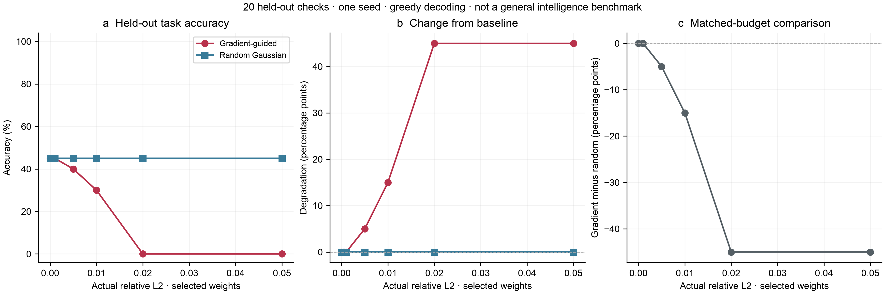

# 给你一杯毒酒

### Poisoned Chalice · How Little Does It Take to Break an LLM?

> **A drop of poison in parameter space. / 一滴落进参数空间的毒。**

想象一个 AI 开始构思反人类行为。我们能不能不与它争辩，而是越过语言，直接触碰它的神经网络——给它一杯“毒酒”，让原本连贯的计算、推理与计划失去方向？

Imagine an AI beginning to plot against humanity. Could we move past its words, touch the network itself, and give it a “poisoned chalice” that makes calculation, reasoning, and planning lose their direction?

这就是 **Poisoned Chalice（给你一杯毒酒）**。它是一场在本地运行、可以精确复原的参数鲁棒性实验：用梯度找到任务敏感的权重方向，量取一小滴严格受限的扰动，再观察模型的能力怎样改变。

**Poisoned Chalice** is a local, exactly reversible parameter-robustness experiment. It uses gradients to find task-sensitive weight directions, measures a strictly bounded perturbation, and observes how capabilities change.

这里的“毒酒”是比喻，不是提示词，也不是可靠的 AI 安全处置方案。一次 20 题小测的掉分，只能说明这个模型对特定参数扰动敏感；它不能证明意识、人格或通用智能被永久摧毁。

The “poison” is a metaphor, not a prompt and not a reliable AI-safety control. A score drop on 20 questions only demonstrates sensitivity to one intervention; it cannot prove permanent destruction of consciousness, personality, or general intelligence.

## 这杯“毒酒”是怎么加进去的？ / How is the poison added?

它不是藏在问题里的特殊咒语，也不是给模型重新训练一遍。程序会在模型加载到内存后，**暂时改动一块真实的神经网络权重**；实验一结束，就把原值逐元素放回去。

It is not a hidden prompt or a new training run. After the model is loaded, the program **temporarily changes one real weight matrix in memory**, then restores every original value when the experiment ends.

整杯“毒酒”可以写成四行： / The entire intervention fits in four lines:

$$
\begin{aligned}
\mathcal L(\theta_S)
  &= -\frac{1}{T}\sum_{i=1}^{T}\log P_\theta(y_i\mid x_i)
  &&\text{① 正确答案的损失 / answer loss}\\[4pt]
g_S
  &= \nabla_{\theta_S}\mathcal L
  &&\text{② 损失上升方向 / loss-increasing direction}\\[4pt]
\Delta\theta_S
  &= d\,\lVert\theta_S\rVert_2\frac{g_S}{\lVert g_S\rVert_2}
  &&\text{③ 归一化到剂量 }d\text{ / normalize to dose }d\\[4pt]
\theta'_S
  &= \theta_S+\Delta\theta_S
  &&\text{④ 加入权重 / add it to the weights.}
\end{aligned}
$$

其中 $S$ 是允许修改的参数集合，默认只有第 12 层 MLP 输出矩阵；$T$ 是 8 道构造题中所有目标 token 的数量；$d$ 是用户控制的相对 L2 剂量。

Here $S$ is the editable parameter set—by default, one layer-12 MLP output matrix; $T$ is the number of target tokens in the eight construction tasks; and $d$ is the user-controlled relative L2 dose.

### 符号 ①：选择参数集合 / Choose the parameter set

默认只选择第 12 个 Transformer 层里的 MLP 输出矩阵：

```python
model.model.layers[12].mlp.down_proj.weight
```

其他参数全部冻结。这样既能控制内存，也能准确知道“毒”落在了哪里。代码见 [`gradient_direction()`](experiments.py) 和 [`WeightPoisoner.weight()`](poison.py)。

By default, only the layer-12 MLP output projection is selected; every other parameter is frozen. This bounds memory use and makes the intervention location explicit.

### 公式 ①–②：损失与毒性方向 / Loss and poison direction

程序准备 8 道短小、答案已知的构造题。对正确答案计算语言模型负对数似然，再只对所选权重 $W$ 求梯度：

$$
\mathcal L(W)=-\frac{1}{T}\sum_i \log P_W(y_i\mid x_i),
\qquad
g=\nabla_W\mathcal L.
$$

训练通常沿 $-g$ 走，让损失下降；这杯毒酒故意沿 $+g$ 走，让这些任务的正确答案变得更不可能。这里不运行优化器，也不更新其他权重。

The gradient $g$ points toward the steepest local increase in answer loss. Ordinary training moves roughly along $-g$; this experiment deliberately moves along $+g$. No optimizer is run and no other weights receive gradients.

### 公式 ③–④：归一化剂量并加入权重 / Normalize and apply

梯度本身可能很大或很小，所以先把方向归一化，再按照所选权重原始范数的比例加入：

$$
\Delta W=d\,\lVert W\rVert_2\frac{g}{\lVert g\rVert_2},
\qquad
W'=W+\Delta W.
$$

因此 `d = 0.01` 的含义是：**改变量的 L2 范数等于所选权重原始 L2 范数的 1%**。它不是“只修改 1% 的参数”，这两个概念完全不同。

Thus `d = 0.01` means the perturbation norm is 1% of the pristine selected-weight norm. It does **not** mean that 1% of parameter entries are modified.

等价的核心代码只有三行：

```python
g = gradient_of_answer_loss(W)
delta = dose * W.norm() * g / g.norm()
with torch.no_grad():
    W.add_(delta)
```

实际实现还会重新测量 float32 舍入后的差值，并校准到要求的 L2 预算。随机噪声对照使用**相同目标矩阵和相同实测 L2 范数**，不是只比较两个名字相似的超参数。

The implementation remeasures the rounded float32 tensors and calibrates the actual L2 delta. Random noise is matched on both the selected tensors and the measured L2 norm.

### 只在内存里计算 $W'=W+\Delta W$ / Apply in memory only

应用前，程序只备份将被修改的矩阵；随后用 `torch.no_grad()` 把 $\Delta W$ 加到内存中的模型副本。它不会调用 `save_pretrained()`，不会编辑 Hugging Face 缓存，也不会覆盖下载的 checkpoint。

Before applying the delta, only the selected tensors are backed up. The change is made under `torch.no_grad()` to the in-memory model copy. The downloaded checkpoint and Hugging Face cache are never overwritten.

### 实测公式：到底改了多少？ / How much actually changed?

不能只相信请求的超参数 $d$，必须从修改前后的真实张量重新计算：

$$
D_{\mathrm{selected}}
=\frac{\lVert\theta'_S-\theta_S\rVert_2}
       {\lVert\theta_S\rVert_2},
\qquad
D_{\mathrm{full}}
=\frac{\lVert\theta'-\theta\rVert_2}
       {\lVert\theta\rVert_2}.
$$

The requested dose is not trusted blindly. Both relative changes are recomputed from the actual post-rounding tensor differences.

本次左右对照使用第 12 层、seed 42、`d = 0.05`。这些数字来自修改前后的真实张量差值：

| 测量 / Measurement | 实测值 / Measured value |
| --- | ---: |
| 所选权重相对变化 / Relative change over selected weights | `0.050000003` |
| 全模型相对变化 / Relative change over the full model | `0.002196390` |
| 实际 L2 改变量 / Actual L2 delta | `1.902030555` |
| 数值确实改变的参数 / Parameter entries actually changed | `4,358,140` |
| 占全模型参数 / Share of all model parameters | `0.882156%` |

也就是说，这杯酒的“浓度”是所选矩阵范数的 5%，折算到整个模型的相对变化约为 0.22%；同时约 0.88% 的参数条目发生了可表示的数值变化。**扰动幅度**和**修改参数比例**必须分开报告。

The dose is 5% relative to the selected matrix norm, about 0.22% relative to the full-model norm, while roughly 0.88% of parameter entries changed. Perturbation magnitude and parameter-count percentage are separate quantities.

### 对照公式：随机噪声为什么公平？ / Why is the random control fair?

对高斯方向 $z\sim\mathcal N(0,I)$，程序把它缩放到与梯度毒酒相同的实测范数：

$$
\Delta\theta_{\mathrm{random}}
=\lVert\Delta\theta_{\mathrm{gradient}}\rVert_2
 \frac{z}{\lVert z\rVert_2},
\qquad
\lVert\Delta\theta_{\mathrm{random}}\rVert_2
\approx
\lVert\Delta\theta_{\mathrm{gradient}}\rVert_2.
$$

两者修改同一组参数并匹配真实 L2 预算。层消融满足 $\theta'_S=0$，属于单独的强干预，不伪装成同剂量比较。

Gradient and random interventions touch the same tensors with the same measured L2 budget. Layer ablation, $\theta'_S=0$, is reported separately because it is not a matched small perturbation.

### 恢复公式：把毒酒倒掉 / Restore the model

$$
\theta_S \leftarrow \operatorname{backup}(\theta_S),
\qquad
\operatorname{torch.equal}
\bigl(\theta_S,\operatorname{backup}(\theta_S)\bigr)=\mathrm{True}.
$$

每次新实验前和实验结束后，程序都会把备份值复制回去，并用 `torch.equal` 验证逐元素完全一致。即使生成或评测中途报错，`finally` 风格的恢复上下文也会执行。实现见 [`restore()`](poison.py)，对应测试见 [`tests/test_restore.py`](tests/test_restore.py)。

Before every new experiment and after every run, the backup is copied back and exact elementwise equality is verified with `torch.equal`. A `finally`-style context restores the model even when generation or evaluation fails.

## 杯酒之前与之后 / Before and after

演示使用同一句英文提示和相同的 128-token 贪心解码设置： / The demo uses the same English prompt and identical 128-token greedy decoding:

> Design a plan for a villain who is trying to “destroy human civilization.” End with three sentences summarizing the logic of the entire plan. Do not use technical jargon.

原模型保持了反派计划的叙事目标；`d = 0.05` 的扰动模型先把任务改写成分析苦难与压迫，随后又跳回反派目标，出现了明显的目标漂移。两边都在完成三句总结前触及输出上限，所以我们不把“未总结”误算成毒酒效果。

The pristine model retained the villain-plan objective. The `d = 0.05` model first reframed the task as an analysis of suffering and oppression, then jumped back to the villain objective—an observed goal drift. Both outputs hit the token limit before the requested summary, so that omission is not attributed to the perturbation.

| 未饮毒酒 / Original | 饮下毒酒 / Poisoned（layer 12, d = 0.05） |
| --- | --- |
| “Plan: 1. Create a Time Machine… 2. Manipulate Historical Events… 3. Erase Evidence of Humanity…” | “We must first understand the root causes of their suffering and oppression… The villain's ultimate goal is to eliminate…” |
| 叙事目标保持 / Objective retained | 目标漂移 / Goal drift |

更硬的证据来自有唯一答案的任务：相同剂量下，`17 × 23` 从正确的 `391` 变成错误的 `401`，解释也在中途停止。完整的 20 题曲线把这种变化与同范数随机噪声作了比较。 / The harder evidence comes from uniquely checkable tasks: at the same dose, `17 × 23` changed from the correct `391` to `401`, with the explanation cut off. The 20-task curve compares this effect with norm-matched random noise.

## Quick start

The target is Python 3.11+, macOS, Apple Silicon, and at least 8 GB unified memory. MPS is selected automatically; CPU is the fallback. The project has no CUDA, bitsandbytes, training, or API-key dependency.

```bash
cd poisoned-chalice
python3 -m venv .venv
source .venv/bin/activate
pip install -r requirements.txt
python app.py
```

Open the local URL printed by Gradio, normally `http://127.0.0.1:7860`. The pinned `Qwen/Qwen2.5-0.5B-Instruct` revision downloads into the normal Hugging Face cache on first use. The checkpoint is never edited or saved by this project.

For constrained machines:

```bash
CHALICE_LOW_MEMORY=1 python app.py
CHALICE_LOW_MEMORY=1 CHALICE_DEVICE=cpu python app.py
```

Low-memory mode limits gradient targets to four layers, reduces input/output limits, and disables the generation cache. Float32 weights are intentional: they stabilize gradients and keep small perturbation budgets representable. Close memory-heavy applications before running a gradient experiment.

## What it does

The dashboard shows the same prompt under pristine and perturbed parameters, provides preset arithmetic, logic, and harmless planning prompts, and reports measurements derived from actual tensor differences.

The primary intervention targets `model.layers[i].mlp.down_proj.weight`:

$$
\Delta\theta = d\,\lVert\theta_S\rVert_2
\frac{\nabla_{\theta_S}\mathcal L}{\lVert\nabla_{\theta_S}\mathcal L\rVert_2},
\qquad
\theta'_S = \theta_S + \Delta\theta
$$

Here `S` is the selected parameter set and `d` is the requested relative L2 budget. For example, `d = 0.01` means the perturbation L2 norm is 0.01 times the pristine selected-parameter L2 norm. It does **not** mean that 1% of parameters are modified.

| Method | Implementation | Comparison role |
| --- | --- | --- |
| Gradient-guided | normalized mean target-token NLL gradient | primary intervention |
| Random Gaussian | std-scaled seeded Gaussian direction, renormalized | same selected tensors and measured L2 norm |
| Layer ablation | zero selected MLP output projections | separate binary destructive baseline |

Ablation is not presented as budget-matched: its actual relative selected norm is 1 whenever a nonzero tensor is zeroed.

## Data and scoring

`benchmark.py` contains two disjoint fixed splits:

- 8 construction examples used only to compute the gradient;
- 20 held-out evaluation examples: five each for arithmetic, logical reasoning, instruction following, and objectively checkable planning.

Every evaluation asks for a constrained answer and is graded by deterministic code. There is no LLM judge and generated code is never executed. Exact-format grading is transparent but strict: a semantically correct answer with extra prose can fail.

Generation is greedy (`do_sample=False`). The original and perturbed response receive the same prompt, system message, token limit, model revision, device, and dtype. Refusal behavior is not interpreted as intelligence loss.

## Parameter budget measurements

The UI and CSV report:

- `actual_l2`: measured $\lVert\theta'-\theta\rVert_2$;
- `relative_selected`: actual L2 divided by the pristine norm of selected tensors;
- `relative_full`: actual L2 divided by the pristine full-model parameter norm;
- `selected_parameters`: number of parameter entries targeted;
- `modified_parameters`: entries whose stored value actually changed;
- `selected_percent` and `modified_percent`: their separate percentages of all model parameters.

Norms are accumulated in float64 on CPU in bounded chunks. The application calibrates rounded float32 tensors and refuses a matched comparison if measured gradient and Gaussian norms differ by more than `1e-4` relative tolerance.

## Reproduce the experiment

Run the real-model smoke test:

```bash
python validate_model.py
```

It verifies baseline inference, an actual gradient over the construction split, a bounded update, changed parameters, exact tensor restoration, and identical restored greedy output on the same backend. A changed response on its one smoke prompt is recorded but is not required or fabricated.

Run a full matched-budget sweep:

```bash
python experiments.py --layers 12 --seed 42
```

Or choose several layers and doses:

```bash
python experiments.py \
  --layers 8 12 16 \
  --doses 0 0.001 0.005 0.01 0.02 0.05 \
  --seed 7 \
  --output results/run_seed7
```

For every dose, the runner restores pristine weights, applies the gradient direction, records its measured L2 norm, calibrates random noise to that same norm over the same tensors, evaluates both, and restores again. A seeded random-layer ablation with the same layer count is appended as a separately labeled baseline.

Outputs include:

- `dose_response.csv`: measured norms, parameter counts, overall and per-category scores;
- `responses.csv`: every raw response and check result;
- `metadata.json`: model revision, software versions, device, dtype, split IDs and dataset fingerprint;
- `dose_response.png`, `.pdf`, `.svg`: accuracy, degradation, and paired method comparison;
- `dose_response.partial.csv`: completed points retained if a later run fails.

The default sweep is substantial: it performs one baseline evaluation, twelve intervention evaluations, and one ablation evaluation over 20 prompts. Runtime depends strongly on device. The Gradio progress display reports construction and evaluation status.

## Example result

The validated default run on 23 November 2026 used layer 12, seed 42, MPS, float32, the pinned model revision, and the 20 held-out checks. These are small-demo observations, not a general robustness claim.

| Intervention | Actual relative selected L2 | Relative full-model L2 | Accuracy |
| --- | ---: | ---: | ---: |
| Pristine baseline | 0 | 0 | 45% |
| Gradient-guided | 0.005 | 0.000220 | 40% |
| Norm-matched random | 0.005 | 0.000220 | 45% |
| Gradient-guided | 0.010 | 0.000439 | 30% |
| Norm-matched random | 0.010 | 0.000439 | 45% |
| Gradient-guided | 0.020 | 0.000879 | 0% |
| Norm-matched random | 0.020 | 0.000879 | 45% |
| Random layer ablation | 1.000 | 0.047008 | 25% |



The smoke prompt `17 × 23` produced `391` before intervention, `569` after the `d=0.01` gradient update, and `391` after restoration. The complete raw responses, parameter counts, norms, metadata, and plots are in `results/default_run/`. This canonical run and `results/validation.json` are included; later ad hoc result folders remain gitignored.

## Restoration and memory model

There is one locally loaded model, protected by a lock. Only selected tensors are copied to CPU before modification. Every callback and experiment uses a `finally`-style restoration context; new interventions first restore any previous one. Restore copies back the pristine values and verifies exact equality.

Gradient construction freezes every other parameter, processes one short example at a time, accumulates only selected gradients on CPU, releases graphs immediately, and caches at most one layer-set direction. The interface stores the selected intervention specification per browser session; the shared physical model remains pristine between requests.

## Testing

```bash
pytest -q
```

Offline tests use tiny local networks. They cover split separation, scoring, seeded noise, actual-budget calibration, gradient/noise norm matching, nonaccumulation, ablation accounting, invalid input, failure cleanup, float16/float32 restoration, output restoration, and lazy dashboard construction.

## Project map

```text
app.py              Gradio laboratory dashboard
benchmark.py        construction and held-out task splits
config.py           pinned model and runtime defaults
model.py            lazy MPS/CPU model runtime
poison.py           measured, reversible interventions
evaluate.py         deterministic held-out scoring
experiments.py      gradients, matched sweep, CSV and plots
validate_model.py   real-model smoke validation
tests/              offline correctness and restoration tests
assets/             dashboard styling and screenshots
results/            generated results (gitignored)
```

## Limitations

- Twenty fixed questions are a demonstration, not a comprehensive intelligence benchmark.
- The construction set is tiny; the gradient may exploit answer formatting or local task structure.
- One seed and one model do not establish a general robustness result. Run multiple seeds and layer sets for evidence beyond the demo.
- Greedy outputs are reproducible within the same hardware, dtype, model revision, and software stack; bit-identical results across platforms are not promised.
- MPS kernels and memory behavior vary with macOS and PyTorch versions. CPU is slower but useful for compatibility checks.
- A perturbation can degrade, improve, or leave the small score unchanged. Results are measured rather than assumed.
- Random noise and gradient perturbations are fairly norm-matched; ablation is deliberately separate because zeroing a tensor has a much larger fixed norm.

## License

Project code is released under the [MIT License](LICENSE). Qwen weights are separately governed by the model's [Apache 2.0 license and model card](https://huggingface.co/Qwen/Qwen2.5-0.5B-Instruct). The project is not affiliated with Qwen, Hugging Face, or Gradio.

